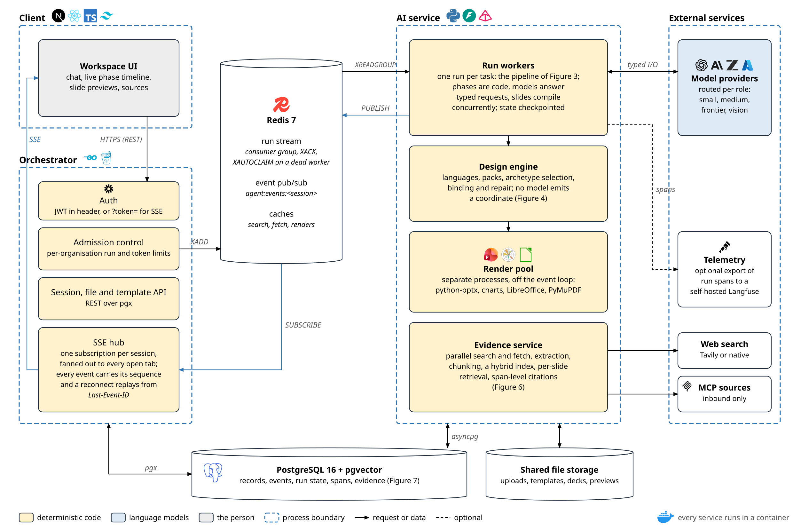
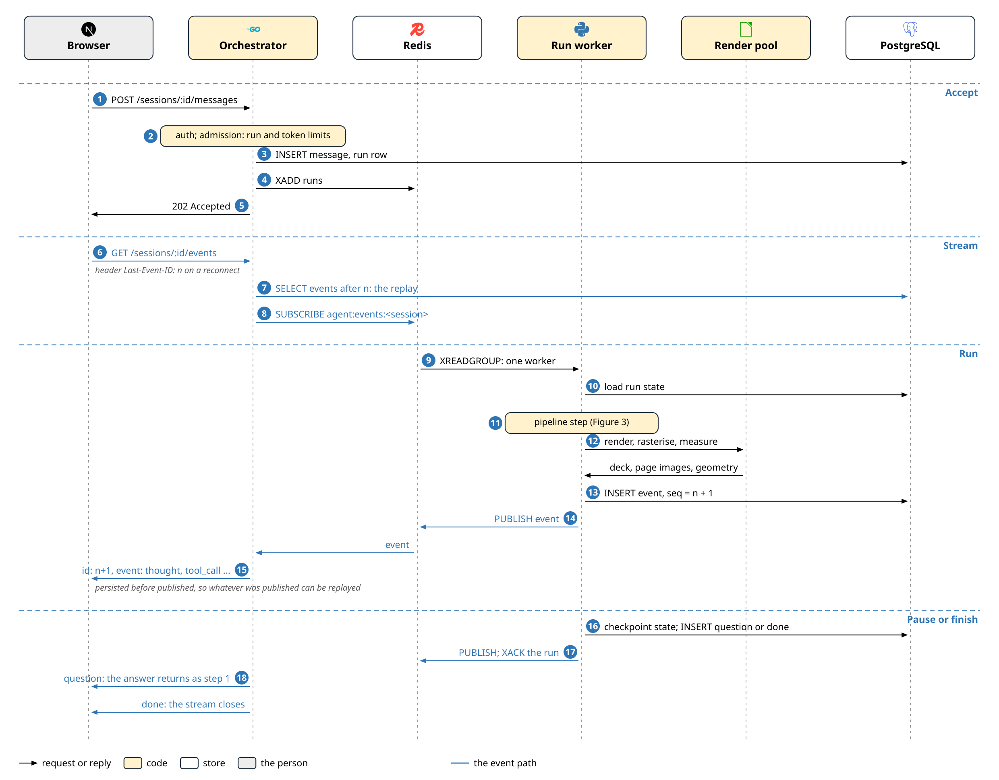
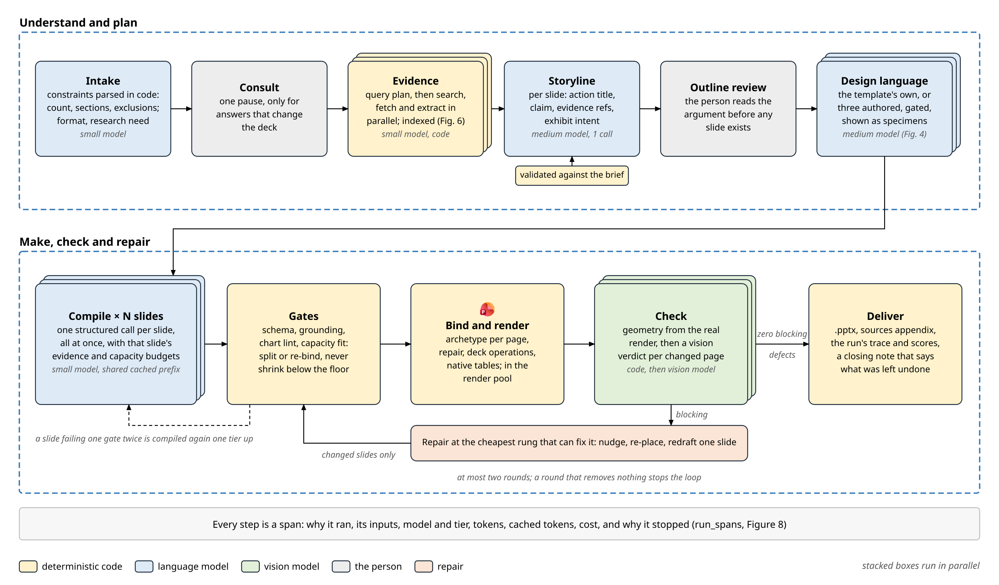
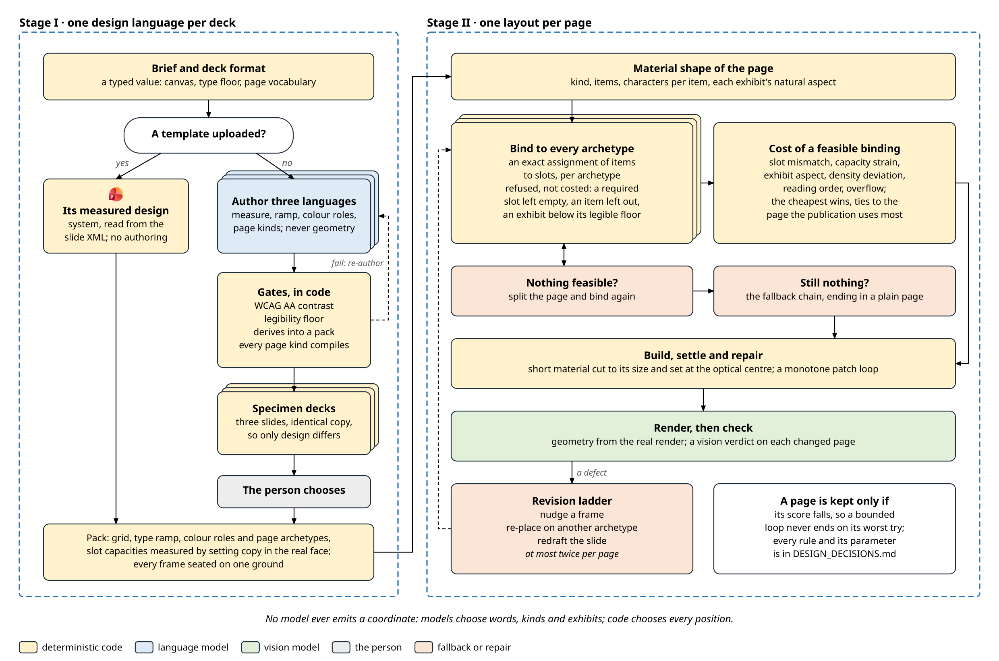
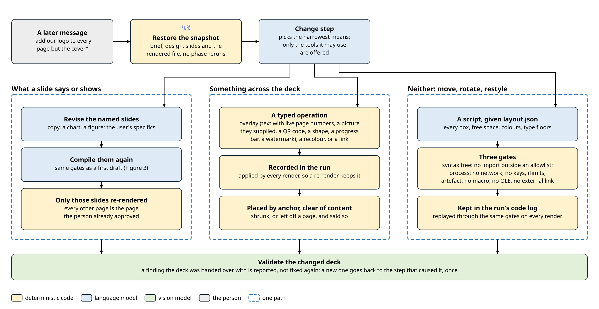
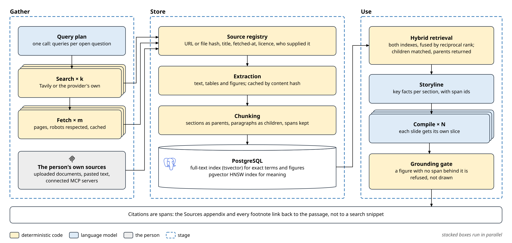
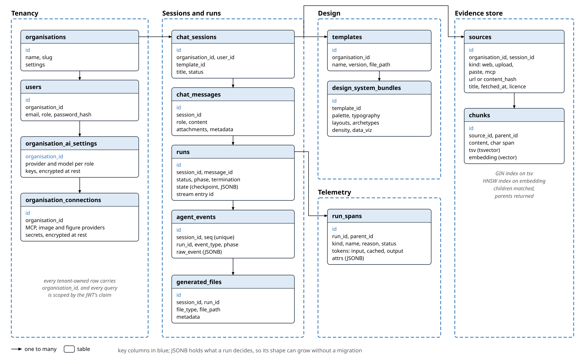
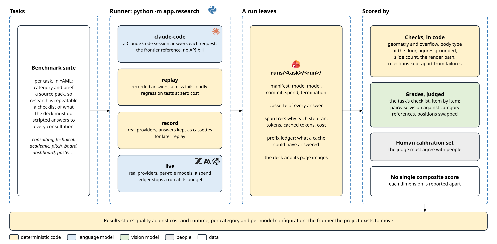

# ThinkSlides

ThinkSlides turns a conversation, the user's documents and the web into a finished, branded PowerPoint deck.
It is built on one bet: small, cheap models inside strong orchestration - typed requests, deterministic gates, retrieval, visual checks and bounded repair - match frontier-model workflows on quality, at a fraction of the cost and in less time.
Every part of the system below exists to make that bet measurable, and to win it.

A user writes what they need, optionally attaching documents and a PPTX or POTX template.
ThinkSlides settles the brief, gathers evidence, writes a storyline the user reviews, chooses or authors a design language, compiles every slide at once, renders the deck, checks the rendered pages, and repairs what fails.
Every step streams to the browser as it happens, and every step is recorded with why it ran, what it cost and why it stopped.

## Contents

- [Architecture](#architecture)
- [Request and event flow](#request-and-event-flow)
- [The generation pipeline](#the-generation-pipeline)
- [How a design and a layout are chosen](#how-a-design-and-a-layout-are-chosen)
- [Amending a finished deck](#amending-a-finished-deck)
- [The evidence store](#the-evidence-store)
- [Data model](#data-model)
- [How a run is measured](#how-a-run-is-measured)
- [Quick start](#quick-start)
- [Technology](#technology)
- [Project structure](#project-structure)
- [Key design decisions](#key-design-decisions)

## Architecture



*Figure 1: The system. Boxes are coloured by what runs in them; dashed blue outlines are process boundaries.*

ThinkSlides is a three-tier system run as containers on one network.

- **Workspace UI** (`apps/web`): Next.js 14 with the App Router, TypeScript, Tailwind CSS and Zustand.
  It shows the chat, a live timeline of the run's phases, slide previews and the sources behind every figure.
- **Orchestrator** (`services/orchestrator`): Go and Gin.
  It is the only HTTP entry point: it authenticates with JWT, admits runs against per-organisation run and token limits, serves the session, file and template API, and runs the SSE hub.
- **AI service** (`services/ai`): Python, FastAPI and Pydantic.
  Run workers execute the pipeline (Figure 3); the design engine places every page (Figure 4); a render pool of separate processes builds and rasterises decks; the evidence service gathers and indexes sources (Figure 6).
- **PostgreSQL 16 with pgvector**: the system of record, including run state, events, spans and the evidence store (Figure 7).
- **Redis 7**: the run stream, the event bus and caches.

A run is handed over through a Redis stream with a consumer group.
A run worker acknowledges it only when the run pauses or finishes, so a worker that dies mid-run leaves the run pending, and another worker claims it and resumes from the last checkpoint in PostgreSQL.
Admission control bounds how many runs an organisation has in flight, so a burst of messages queues rather than starving every other tenant.

Rendering never runs on the event loop.
python-pptx composition, chart drawing, LibreOffice conversion and PyMuPDF rasterisation run in a pool of separate processes, so one deck's render does not stall the streams, model calls and compile requests of every other run in the same service.

Models are called per role.
Each step names a tier - small, medium, frontier or vision - and the workspace maps tiers to models from any configured provider: OpenAI, Anthropic, Z.ai (Zhipu GLM) or Azure OpenAI.
Classification, query planning, slide compile and rewrites run on the small tier; the storyline and design-language authoring on the medium tier; a step escalates one tier only when its output fails the same gate twice.

## Request and event flow



*Figure 2: One message, from the POST to the closed stream. Numbers mark the steps; blue arrows are the event path.*

A message is accepted in milliseconds: the orchestrator authenticates it, admits it, stores it and appends the run to the stream, then answers `202 Accepted`.
The browser opens an SSE connection for the session, passing its JWT as `?token=` because `EventSource` cannot set headers.

Every event a run produces is written to `agent_events` with a per-session sequence number before it is published.
The SSE hub sends that number as the event's `id`, so a browser that drops and reconnects sends `Last-Event-ID`, receives exactly the events it missed from PostgreSQL, and then continues live.
Persisting before publishing is what makes that replay complete: nothing can be seen live that cannot be replayed.

A run pauses by checkpointing its state and emitting a `question` event; the answer arrives as an ordinary message and resumes the run where it stopped.
A finished run emits `done` and the stream closes.

Event types: `thought`, `tool_call`, `tool_result` (with cited sources), `slide_finalized`, `file_generated`, `progress`, `question`, `timer_update`, `session_title_updated`, `error`, `done`.

## The generation pipeline



*Figure 3: The pipeline. Stacked boxes run in parallel; the person is consulted at most twice; the repair loop is bounded.*

No model decides what happens next.
The pipeline is a table of phases walked by code (`services/ai/app/agent/pipeline.py`); a model is asked a typed question at a step, answers it, and the code checks the answer.

1. **Intake** parses the constraints a brief states - slide count, sections, exclusions - in code, and asks the small model only what code cannot read: the deck's format and whether it needs research.
2. **Consult** pauses once, and only for questions whose answers change the deck.
3. **Evidence** plans its queries in one call, then searches and fetches in parallel and indexes what it found (Figure 6).
4. **Storyline** is written once, by the medium model, as a typed artefact: per slide, an action title, the claim, the evidence it rests on and the exhibit it needs; code validates it against the brief before anyone sees it.
5. **Outline review** shows the argument to the person before any slide exists.
6. **Design language**: the uploaded template's own, or three authored languages the person chooses between (Figure 4).
7. **Compile** asks for every slide at once, one structured call per slide on the small model, each with its own evidence slice and capacity budgets and all sharing one cached prompt prefix.
8. **Gates** check each answer in code: schema, grounding (every figure bound to a source span), chart lint and capacity fit.
   Copy that does not fit is split or re-bound, never shrunk below the type floor.
9. **Bind and render** places each page on its archetype, applies the deck's operations and renders in the render pool.
10. **Check** measures the real rendered geometry, then asks the vision model for a verdict on each page that changed.
11. **Repair** fixes a blocking defect at the cheapest rung that can: nudge a frame, re-place the page on another archetype, or redraft one slide.
    Only changed slides are compiled, rendered and checked again; there are at most two rounds, and a round that removes nothing ends the loop.
12. **Deliver** writes the `.pptx` with its sources appendix, the run's trace and scores, and a closing note that says plainly what was left undone.

## How a design and a layout are chosen



*Figure 4: Stage I settles one design language per deck; Stage II chooses one layout per page from that page's own material.*

No model ever emits a coordinate.
That constraint is what the whole selection path is built around: a model asked for rectangles invents them, and the failures that follow are invisible until someone looks at the rendered page.

**Stage I settles one design language for the deck.**
The deck format is a typed value - a pitch, a boardroom deck, an academic talk, a dashboard, a conference poster - and it sets the canvas, the type floor and the page vocabulary.
An uploaded template's measured design system is used as it is.
Otherwise a model authors three languages, stating the measure, the type ramp, the colour roles and the kinds of page the deck needs, and nothing else.
Code derives each into a pack - the grid, the ramp in points, and page archetypes whose slot capacities are measured by setting copy in the real face - and gates it: WCAG AA contrast, the canvas-relative legibility floor, and every page kind compiling.
A rejected language is re-authored with the reason it failed.
Each survivor renders a three-slide specimen deck with identical copy, so the person compares design rather than wording.
As a pack loads, every frame that would sit across two grounds is seated on one, so no copy or chart is ever inked for a ground it is not on.

**Stage II decides each page's layout from that page's own material.**
A slide is read into a material shape: what kind of page it is, how many items it carries, how long each is, and each exhibit's natural aspect.
Every archetype is tried by an exact assignment of items to slots.
A binding that leaves a required slot empty, drops an item, or sets an exhibit below its legible size is refused rather than costed; the rest are costed on slot mismatch, capacity strain, exhibit aspect, density, reading order and overflow, and the cheapest wins.
A page nothing can carry is split and tried again, and a page that still fits nowhere falls back along a fixed chain that ends in a plain page.
The page is then built, short material is cut to its size and set at the optical centre, and a monotone patch loop repairs it - a patch is kept only if the page's score falls.

Every rule, weight, threshold and fallback, with its parameters, rationale and the runs that motivated it, is in [`docs/DESIGN_DECISIONS.md`](docs/DESIGN_DECISIONS.md).

## Amending a finished deck



*Figure 5: A later message changes the finished deck by the narrowest means that can.*

A message sent after a deck is finished changes that deck; it does not start a new one.
The run's snapshot is restored - brief, design, slides and the rendered file - and the change step is offered only the tools that fit the request.

- **What a slide says or shows** goes back to compile for the named slides, through the same gates as a first draft, and only those slides are re-rendered.
- **Something across the deck** - a logo in a corner, a footer with live page numbers, a QR code, a progress bar, a watermark, a recolour, a link on every mention of a phrase - is a typed operation.
  It is recorded in the run and applied by every render, placed by anchor clear of each page's content and the template's own master shapes, shrunk or left off a page where it would cover something, and reported either way.
- **Only what neither can say** - moving, rotating or restyling something already on a page - is written as a Python script.
  The script reads `layout.json`, the deck as the engine sees it: every page's boxes, the free space along its edges with the ground under each, the margins, the deck's colours and face, and its type floors.
  It passes three gates: its syntax tree (no import outside an allowlist, no `eval`, no absolute path), its process (no network, no keys, CPU, memory and file limits), and its artefact (no macro, no OLE object, no external relationship).
  The script is kept in the run's code log and replayed through the same gates on every later render.

The changed deck is validated again.
A finding the deck was handed over with is reported, not fixed again; a new one goes back, once, to the step that caused it.

## The evidence store



*Figure 6: Research is gathered in parallel, stored as sources, chunks and spans, and retrieved per slide.*

Research is planned once and then runs wide: searches and page fetches run in parallel, alongside the person's own uploads, pasted text and connected MCP servers.
Each source is registered with its URL or content hash, title, fetch time and licence; its text, tables and figures are extracted once and cached by content hash; and it is chunked into sections and paragraphs with character spans kept.

Retrieval is hybrid.
PostgreSQL's full-text index finds exact terms and figures, a pgvector HNSW index finds meaning, and the two rankings are fused by reciprocal rank; paragraphs are matched and their sections returned.
The storyline retrieves per section and compile retrieves per slide, so each call carries only its own slice.
A figure on a slide with no span behind it is refused by the grounding gate rather than drawn, and every citation in the deck links to the passage it came from.

## Data model



*Figure 7: The tables in PostgreSQL, grouped by concern. Arrows run from one to many.*

Every tenant-owned row carries `organisation_id`, and every query is scoped by the JWT's claim.
A session holds messages and runs; a run holds its checkpointed state, its events and its spans.
Events carry a per-session sequence, which is what SSE replay reads.
Provider keys and connection secrets are encrypted at rest.
What a run decides lives in JSONB, so its shape can grow without a migration, while everything a query filters on is a column.

## How a run is measured



*Figure 8: The benchmark harness. One runner, four modes, and scores kept per dimension.*

The pipeline runs headless through `python -m app.research`, in one of four modes:

- `claude-code`: a Claude Code session answers each model request, which gives a frontier reference with no API bill;
- `replay`: recorded answers only, so regression tests cost nothing and a cache miss fails loudly;
- `record`: real providers, with every answer kept as a cassette;
- `live`: real providers on per-role models, with a spend ledger that stops a run at its budget.

Every run leaves its manifest, a cassette of every answer, its span tree, a prefix ledger of what a prompt cache could have served, and the deck with its page images.
Deterministic checks score geometry, overflow, body type at the floor, grounding, slide count and the render path; judges grade each task's checklist item by item and compare decks pairwise against category references, positions swapped, calibrated against a human set.
No composite score is formed: each dimension is reported apart, per category and per model configuration, which is what the quality and cost frontier is drawn from.

## Quick start

### Prerequisites

- Docker and Docker Compose v2 or later
- Node.js 20 or later (frontend development)
- Python 3.11 or later (AI service development)
- Go 1.22 or later (orchestrator development)
- Make

### Run the full stack

```bash
cp .env.example .env    # then set your provider keys
make dev                # start every service
make migrate            # run the database migrations

# Frontend:      http://localhost:3000
# Orchestrator:  http://localhost:8080
# AI service:    http://localhost:8000
```

### Individual services

```bash
make dev-web            # frontend only
make dev-ai             # AI service only
make dev-orchestrator   # orchestrator only
```

### Build and test

```bash
make build              # build every image
make test               # run every test suite
make test-ai            # AI service
make test-orchestrator  # orchestrator
make test-web           # frontend
```

### Run the pipeline headless

```bash
cd services/ai
PYTHONPATH=. .venv/bin/python -m app.research run ../../benchmark/tasks/technical/http-caching.yaml --mode replay \
    --cassette ../../benchmark/evidence/technical-http-caching/20261012-162837-claude-code/cassette.jsonl
```

## Technology

| Layer | Technologies |
| --- | --- |
| Frontend | Next.js 14 (App Router), React, TypeScript, Tailwind CSS, Zustand, EventSource |
| Orchestrator | Go, Gin, pgx, go-redis, golang-jwt |
| AI service | Python 3.11, FastAPI, Pydantic, SQLAlchemy 2 (async), asyncpg, Alembic, structlog |
| Models | per-role tiers over OpenAI, Anthropic, Z.ai (Zhipu GLM) and Azure OpenAI |
| Search | Tavily or the provider's native search, page fetch, MCP sources |
| Rendering | python-pptx, lxml, matplotlib, LibreOffice headless, PyMuPDF |
| Data | PostgreSQL 16 with pgvector (HNSW) and full-text search, Redis 7 streams and pub/sub |
| Telemetry | run spans in PostgreSQL; optional OpenTelemetry export to a self-hosted Langfuse |

## Project structure

```
.
├── apps/web/                   Next.js workspace UI
├── services/
│   ├── orchestrator/           Go gateway: auth, admission, API, run stream, SSE hub
│   └── ai/
│       ├── app/agent/          pipeline, compile, tools, sandbox
│       ├── app/design/         design languages, packs, selection, binding, repair
│       ├── app/renderer/       composition, deck operations, charts, diagrams, previews
│       ├── app/research/       headless runner, checks, grades, ledger
│       └── tests/
├── packages/schemas/           shared TypeScript and Pydantic contracts
├── db/migrations/              SQL migrations
├── benchmark/                  tasks, evidence runs and reports
└── docs/
    ├── PROJECT_PLAN.md         mission, decisions, roadmap
    ├── DESIGN_DECISIONS.md     every rule the design engine uses, with its evidence
    └── diagrams/               the figures above, and the code that draws them
```

The figures are code: `docs/diagrams/src/figures.py` draws each one, and `services/ai/.venv/bin/python docs/diagrams/src/figures.py` redraws them all.
Products are shown by their own logos, from [Simple Icons](https://simpleicons.org/) and Wikimedia Commons, listed in `docs/diagrams/src/logos/logos.json`.

## Key design decisions

The full record, with dates and evidence, is section 23 of [`docs/PROJECT_PLAN.md`](docs/PROJECT_PLAN.md).

1. **No model emits geometry.** Models choose words, kinds and exhibits; code chooses every position.
2. **Phases are code, not a model's choice.** A model answers a typed question at a step; it never decides the next step.
3. **Compile, do not converse.** A storyline is written once, then every slide is compiled at once by a small model behind deterministic gates.
4. **Gates before eyes.** Deterministic checks run before any vision call, and vision looks only at pages that changed.
5. **Repairs are bounded and monotone.** The cheapest effective rung, at most two rounds, kept only if the score falls, stopped when a round removes nothing.
6. **Every figure is grounded.** A number on a slide is bound to a source span or it is not drawn.
7. **At-least-once runs, replayable events.** Runs travel on a Redis stream with acknowledgement; events are persisted before they are published and replayed by `Last-Event-ID`.
8. **Rendering off the event loop.** Composition, conversion and rasterisation run in a process pool.
9. **One store.** PostgreSQL holds records, run state, spans and the evidence store, with full-text and HNSW indexes side by side; there is no separate vector database.
10. **Measured, not assumed.** Every run is traced, and quality is reported per dimension, never as one score.
